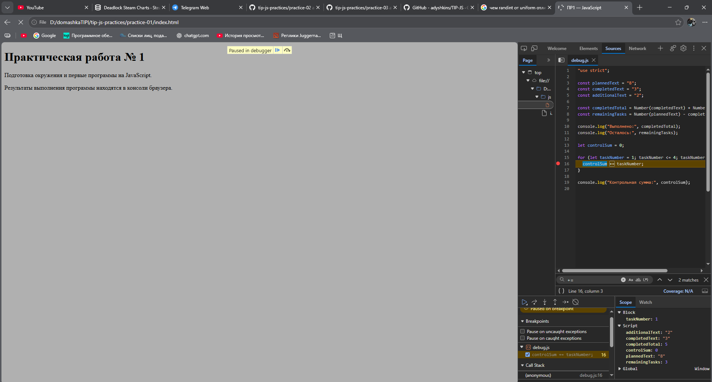

# Практическая работа № 1. Подготовка окружения и первые программы на JavaScript

## 1. Автор и вариант

- **Студент:** Преснухин Илья
- **Группа:** ЭФБО-12-25
- **Номер в списке:** 16
- **Вариант:** `((16 - 1) % 8) + 1 = 8` → `totalTasks = 14`, `completedTasks = 4`, `dailyLimit = 4`

## 2. Окружение

| Инструмент | Версия |
|---|---|
| ОС | Windows 10 Pro 10.0.19045 |
| Node.js | v24.20.0 (ветка 24 LTS) |
| npm | 11.19.0 |
| Git | 2.53.0.windows.2 |
| Браузер | Google Chrome |

```text
> node --version
v24.20.0
> npm --version
11.19.0
> git --version
git version 2.53.0.windows.2
```

## 3. Запуск

Все команды выполняются **из корня репозитория** `tip-js-practices`:

```bash
node practice-01/js/hello.js
node practice-01/js/types.js
node practice-01/js/progress.js
node practice-01/js/plan.js
node practice-01/js/debug.js
node practice-01/js/plan-week.js   # дополнительное задание
```

Запуск в браузере: открыть `practice-01/index.html`, в теге `<script src="./js/hello.js" defer>` заменить путь на нужный файл, сохранить, перезагрузить страницу и открыть DevTools → **Console**. Одновременно подключается только один файл.

Входные данные заданий 3 и 4 задаются константами в начале файлов `progress.js` и `plan.js`.

## 4. Задание 1. Один файл — две среды выполнения

Вывод `node practice-01/js/hello.js` (терминал):

```text
Студент: Преснухин Илья
Группа: ЭФБО-12-25
Практическая работа: 1
JavaScript успешно запущен
Тип document: undefined
```

Вывод в браузере (DevTools → Console, страница `index.html`):

```text
Студент: Преснухин Илья
Группа: ЭФБО-12-25
Практическая работа: 1
JavaScript успешно запущен
Тип document: object
```

Первые четыре строки совпадают. Отличается последняя: в браузере есть объект `document` (DOM загруженной страницы), поэтому `typeof document` даёт `object`. Node.js при обычном запуске файла не создаёт HTML-страницу и не предоставляет DOM, поэтому `document` не определён и получается `undefined`. Вывод в обоих случаях находится только в консоли (терминал / Console), на самой HTML-странице он не появляется.

## 5. Задание 2. Типы и преобразования

| № | Выражение | Ожидание до запуска | Фактическое значение | Тип результата | Объяснение |
|---:|---|---|---|---|---|
| 1 | `"8" + 2` | `"82"` | `82` | `string` | Если один из операндов `+` строка, число приводится к строке и выполняется конкатенация. |
| 2 | `"8" - 2` | `6` | `6` | `number` | Оператор `-` определён только для чисел, поэтому строка `"8"` неявно преобразуется в число. |
| 3 | `Number("8") + 2` | `10` | `10` | `number` | Строка явно преобразована в число, дальше обычное сложение. |
| 4 | `"12" > "3"` | `false` | `false` | `boolean` | Обе стороны — строки, сравнение посимвольное: `"1"` < `"3"`, поэтому `"12"` «меньше». |
| 5 | `12 === "12"` | `false` | `false` | `boolean` | Строгое равенство не приводит типы: число и строка не равны. |
| 6 | `Number("")` | `0` | `0` | `number` | Пустая строка (и строка из пробелов) преобразуется в `0`, а не в `NaN`, поэтому `Number()` не является проверкой ввода. |
| 7 | `Number("text")` | `NaN` | `NaN` | `number` | Строку нельзя разобрать как число — результат `NaN`, но он всё равно имеет тип `number`. |
| 8 | `Boolean("false")` | `true` | `true` | `boolean` | Любая непустая строка истинна; содержимое текста не интерпретируется. |
| 9 | `typeof null` | `"object"` | `object` | `string` | Историческая особенность языка: `null` — примитив, но `typeof` возвращает `"object"`. Сам результат `typeof` всегда строка. |
| 10 | `typeof NaN` | `"number"` | `number` | `string` | `NaN` — специальное значение числового типа. Результат `typeof` — строка `"number"`. |

Фактический вывод `node practice-01/js/types.js`:

```text
1. "8" + 2 = 82 | тип: string
2. "8" - 2 = 6 | тип: number
3. Number("8") + 2 = 10 | тип: number
4. "12" > "3" = false | тип: boolean
5. 12 === "12" = false | тип: boolean
6. Number("") = 0 | тип: number
7. Number("text") = NaN | тип: number
8. Boolean("false") = true | тип: boolean
9. typeof null = object | тип: string
10. typeof NaN = number | тип: string
```

## 6. Задание 3. Сводка выполнения задач (`progress.js`)

Порядок проверок: тип `number` → конечное число (отсекает `NaN`, `Infinity`) → целое → неотрицательное → не больше 1000 → `completedTasks <= totalTasks` → случай «нет задач» → расчёт. Статус определяется по исходным количествам, а не по округлённому проценту. При `0/0` деление не выполняется.

Вывод для варианта 8 (`14`, `4`):

```text
Всего задач: 14
Выполнено: 4
Осталось: 10
Прогресс: 28.6%
Статус: В работе
```

| Проверка | Входные данные | Ожидаемый результат | Фактический результат | Итог |
|---|---|---|---|---|
| Вариант 8 | `14`, `4` | Осталось 10; 28.6%; «В работе» | Осталось: 10; Прогресс: 28.6%; Статус: В работе | Пройдено |
| Обычный случай | `12`, `5` | Осталось 7; 41.7%; «В работе» | Осталось: 7; Прогресс: 41.7%; Статус: В работе | Пройдено |
| Нет задач | `0`, `0` | «Задач пока нет», без процента | Задач пока нет | Пройдено |
| Не начато | `5`, `0` | Осталось 5; 0.0%; «Не начато» | Осталось: 5; Прогресс: 0.0%; Статус: Не начато | Пройдено |
| Завершено | `5`, `5` | Осталось 0; 100.0%; «Завершено» | Осталось: 0; Прогресс: 100.0%; Статус: Завершено | Пройдено |
| Выполнено больше | `5`, `6` | Ошибка | Ошибка: выполненных задач больше, чем существует | Пройдено |
| Отрицательное | `-1`, `0` | Ошибка | Ошибка: количество задач не может быть отрицательным | Пройдено |
| Дробное | `5`, `2.5` | Ошибка | Ошибка: количество задач должно быть целым числом | Пройдено |
| Строка | `"5"`, `2` | Ошибка | Ошибка: количество задач должно быть числом, а не строкой или другим типом | Пройдено |
| Верхняя граница | `1001`, `0` | Ошибка | Ошибка: общее количество задач не может превышать 1000 | Пройдено |
| NaN | `NaN`, `0` | Ошибка | Ошибка: недопустимое числовое значение (NaN или бесконечность) | Пройдено |
| Граница 1000 (доп.) | `1000`, `1000` | Допустимо; 100.0%; «Завершено» | Осталось: 0; Прогресс: 100.0%; Статус: Завершено | Пройдено |
| Задач 0, выполнено 1 (доп.) | `0`, `1` | Ошибка | Ошибка: выполненных задач больше, чем существует | Пройдено |

## 7. Задание 4. План по дням (`plan.js`)

Сначала проверяются количества задач (как в задании 3), затем `dailyLimit` (тип, целое, диапазон 1…1000). При ошибке цикл не запускается. В цикле `while` на каждый день берётся `Math.min(dailyLimit, remainingTasks)`, поэтому в последний день выполняется не больше, чем осталось, и остаток не уходит в минус. Цикл завершается, т.к. `dailyLimit >= 1` и остаток уменьшается каждую итерацию.

Вывод для варианта 8 (`14`, `4`, `4`):

```text
Осталось задач: 10
День 1: выполнено 4, осталось 6
День 2: выполнено 4, осталось 2
День 3: выполнено 2, осталось 0
Потребуется дней: 3
```

| Проверка | Входные данные | Ожидаемый результат | Фактический результат | Итог |
|---|---|---|---|---|
| Вариант 8 | `14`, `4`, `4` | 3 дня: 4, 4, 2 | День 1: 4; День 2: 4; День 3: 2; Потребуется дней: 3 | Пройдено |
| Общий пример | `12`, `5`, `3` | 3 дня, в последний 1 задача | День 1: 3; День 2: 3; День 3: 1; Потребуется дней: 3 | Пройдено |
| Ровное деление | `10`, `4`, `3` | 2 дня по 3 | День 1: 3; День 2: 3; Потребуется дней: 2 | Пройдено |
| Норма больше остатка | `5`, `3`, `10` | 1 день, выполнено 2 | День 1: выполнено 2, осталось 0; Потребуется дней: 1 | Пройдено |
| Всё выполнено | `5`, `5`, `2` | 0 дней, цикл не выполняется | Осталось задач: 0; Все задачи уже выполнены; Потребуется дней: 0 | Пройдено |
| Нет задач | `0`, `0`, `2` | 0 дней, цикл не выполняется | Осталось задач: 0; Все задачи уже выполнены; Потребуется дней: 0 | Пройдено |
| Норма 0 | `5`, `2`, `0` | Ошибка, цикл не запускается | Ошибка: дневная норма должна быть от 1 до 1000 | Пройдено |
| Дробная норма | `5`, `2`, `1.5` | Ошибка | Ошибка: дневная норма должна быть целым числом | Пройдено |
| Выполнено больше | `5`, `6`, `2` | Ошибка | Ошибка: выполненных задач больше, чем существует | Пройдено |
| Норма строкой | `5`, `2`, `"2"` | Ошибка | Ошибка: дневная норма должна быть числом, а не строкой или другим типом | Пройдено |
| Норма > 1000 | `5`, `2`, `1001` | Ошибка | Ошибка: дневная норма должна быть от 1 до 1000 | Пройдено |
| Норма NaN (доп.) | `5`, `2`, `NaN` | Ошибка, без бесконечного цикла | Ошибка: дневная норма должна быть целым числом | Пройдено |
| Максимум (доп.) | `1000`, `0`, `1` | 1000 дней | … День 1000: выполнено 1, осталось 0; Потребуется дней: 1000 | Пройдено |

## 8. Задание 5. Отладка (`debug.js`)

Исходный вывод (до исправления, версия сохранена в первом коммите):

```text
Выполнено: 32
Осталось: -24
Контрольная сумма: 6
```

Исключений не было, но результат неверный. Точка останова на строке `const completedTotal = ...` показала, что `completedText = "3"` и `additionalText = "2"` имеют тип `string`. После шага Step over `completedTotal` стал строкой `"32"`. Точка останова внутри цикла показала, что `taskNumber` принимает значения 1, 2, 3, а при `taskNumber = 4` условие `4 < 4` ложно и цикл завершается, так что `controlSum = 6`.



| Ошибка | Что наблюдалось | Причина | Исправление | Результат после исправления |
|---|---|---|---|---|
| Обработка количества задач | `Выполнено: 32`, `Осталось: -24` | Исходные данные — строки, `+` склеил `"3"` и `"2"` в `"32"`; затем `"8" - "32"` неявно дало `-24` | Явное преобразование: `Number(completedText) + Number(additionalText)` и `Number(plannedText) - completedTotal` | `Выполнено: 5`, `Осталось: 3` |
| Граница цикла | `Контрольная сумма: 6` | Условие `taskNumber < 4` не включает 4-ю задачу (1+2+3) | Условие заменено на `taskNumber <= 4` | `Контрольная сумма: 10` |

Вывод после исправления (Node.js и браузер):

```text
Выполнено: 5
Осталось: 3
Контрольная сумма: 10
```

## 9. Дополнительное задание. Вариант Б: план с выходными (`plan-week.js`)

Первый календарный день — понедельник. День недели вычисляется как `((calendarDay - 1) % 7) + 1`; значения 6 и 7 — суббота и воскресенье, в них задачи не выполняются. Отдельно считаются рабочие и календарные дни. Цикл завершается сразу после выполнения последней задачи, поэтому лишние выходные в конце не добавляются. Проверки входных данных — те же, что в задании 4.

| Проверка | Входные данные | Ожидаемый результат | Фактический результат | Итог |
|---|---|---|---|---|
| Контрольный случай | `6`, `0`, `1` | 6 рабочих, 8 календарных | Пн–Пт по 1, Сб и Вс выходные, Пн 1; Рабочих дней: 6; Календарных дней: 8 | Пройдено |
| Нет оставшихся задач | `0`, `0`, `3` | 0 и 0 | Все задачи уже выполнены; Рабочих дней: 0; Календарных дней: 0 | Пройдено |
| Укладывается в неделю | `10`, `0`, `3` | 4 рабочих, 4 календарных | 3, 3, 3, 1; Рабочих дней: 4; Календарных дней: 4 | Пройдено |
| Завершение в пятницу | `10`, `0`, `2` | 5 и 5, выходные не добавляются | День 5 (пт): осталось 0; Рабочих дней: 5; Календарных дней: 5 | Пройдено |
| Переход через выходные | `12`, `0`, `2` | 6 рабочих, 8 календарных | Пн–Пт по 2, Сб/Вс выходные, Пн 2; Рабочих дней: 6; Календарных дней: 8 | Пройдено |
| Некорректная норма | `5`, `2`, `0` | Ошибка | Ошибка: дневная норма должна быть от 1 до 1000 | Пройдено |
| Вариант 8 | `14`, `4`, `4` | 3 и 3 | 4, 4, 2; Рабочих дней: 3; Календарных дней: 3 | Пройдено |

## 10. Вывод

В работе настроено окружение (Node.js 24 LTS, npm, Git), освоен запуск одного и того же JavaScript-файла в Node.js и в браузере, работа с `const`/`let`, типами, явным преобразованием, условиями и циклами `for`/`while`. Для расчётов реализована проверка входных данных по типу, целочисленности и диапазону, в том числе граничные и ошибочные случаи, а также пошаговый план выполнения задач с корректной последней итерацией.

Самой показательной оказалась ошибка в `debug.js` со сложением строк: программа не падает и выдаёт правдоподобные числа, но `"3" + "2"` даёт `"32"`, и неверный результат дальше «тихо» распространяется по вычислениям. Это хорошо видно только при пошаговой отладке с просмотром типов переменных.
